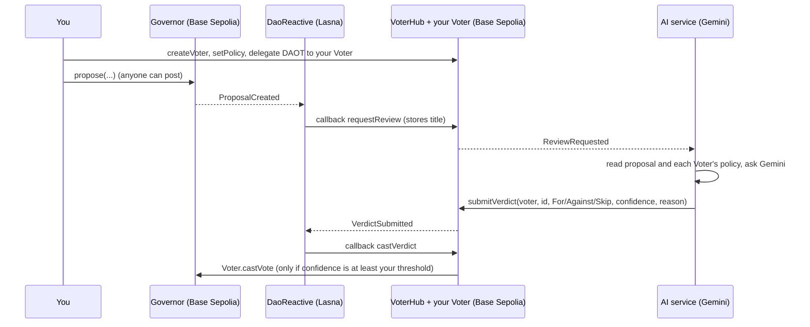

# DAO Autopilot

Write your DAO voting policy in plain language. When a proposal appears, an AI reads it against your policy and your wallet votes for you, automatically, with the reason stored on-chain.

Built for the Reactive Omni Buildathon, track **Reactive Meets AI**. Runs on **Base Sepolia** (token, Governor, voters) and **Reactive Lasna** (the reactive contract). Test networks only, no real funds.

- App: _deploy link to be added_
- Demo video: _link to be added_
- Contract addresses: see [Deployed contracts](#deployed-contracts)

## Why it is different

Other AI entries in this track score prices or risk. DAO Autopilot reads the **text of a proposal** and compares it to **your own written policy**. The whole loop runs through Reactive callbacks, and every step is a public transaction you can open from the app.

## How it works



1. **Round 1, event to callback.** The Governor emits `ProposalCreated`. The reactive contract on Lasna sees it and calls `VoterHub.requestReview` on Base Sepolia.
2. **AI.** The off-chain service listens for `ReviewRequested`, reads the full proposal text and the policy of every registered Voter, and asks Gemini for a verdict (For, Against or Skip), a confidence from 0 to 100 and a reason.
3. **Round 2, AI to vote.** The service submits the verdict through `VoterHub`. The reactive contract sees `VerdictSubmitted` and calls `VoterHub.castVerdict`, and your Voter casts the vote with the tokens you delegated.

Each wallet gets its own Voter with its own policy and its own confidence threshold. Below the threshold, or on Skip, the Voter does not vote and the app tells you why.

## Try it

1. Open the app, connect a test wallet on Base Sepolia (get test ETH from a [faucet](https://www.alchemy.com/faucets/base-sepolia)).
2. Mint test tokens (DAOT), create your Voter, delegate to it, write a policy. The app walks you through the order and explains what is missing at each step.
3. Post a test proposal (or use an example). Voting opens after 1 minute and runs 5 minutes. Watch the trail: Posted, Relayed, Verdict, Vote, each stop linked to its transaction.

Delegate **before** a proposal is posted: votes are counted when a proposal opens.

## Measured

Median over 5 runs: event to callback 2.6 s, verdict to vote 1.6 s, Gemini 2.3 s. Full numbers and every transaction hash are in [submission/measurements.md](submission/measurements.md).

## Deployed contracts

Base Sepolia (chain 84532), all verified on Sourcify:

| Contract | Address |
|---|---|
| GovToken (DAOT) | `0x20C623ae1dA4C32d096443097A6d523c1B2caf60` |
| TestGovernor | `0x57A847aDB9ea784678F7582CBf54252952eF9eFe` |
| VoterHub | `0xDBb35daa3b7992f5AE2CaFbcEe8C36B574a8564d` |
| Callback proxy (Reactive) | `0x476F44b11F5C942c58f4c8E3d0300E5710743585` |

Reactive Lasna (chain 5318007):

| Contract | Address |
|---|---|
| DaoReactive | `0xb9D20116d1f388c7Df7f916f9f06F1ad5D929b9a` |

Registered AI address: `0x8D41Be50E8aDC8892ca03A9CE3d0998AE6eB9637`.

## Trust assumptions and limits

- **One AI address** is registered on the Hub and can submit a verdict for any Voter. That is the central trust point. You stay in control through your confidence threshold and by voting manually from your Voter.
- Anyone can create a Voter, and the AI service judges at most 50 Voters per proposal, so an empty-Voter flood could crowd out later users on a real deployment. Voters without a policy are skipped without calling the model.
- Votes are counted when a proposal opens, so delegate first.
- Governor timings are short on purpose (60 s delay, 5 min voting) so a demo shows a full cycle.

Security notes, Slither results and test coverage: [submission/security.md](submission/security.md).

## Run it yourself

Needs Node 20+, [Foundry](https://book.getfoundry.sh/), a Gemini API key.

```bash
cp .env.example .env          # fill in keys and addresses, never commit it
```

**Contracts**

```bash
cd contracts
forge install --no-git foundry-rs/forge-std OpenZeppelin/openzeppelin-contracts@v5.4.0 Reactive-Network/reactive-lib-omni
forge test                    # 36 tests
```

**AI service** (must be running for verdicts to be sent)

```bash
cd ai-service && npm install && npm start
```

**App**

```bash
cd frontend && npm install && npm run dev
```

Optional: set `VITE_WALLETCONNECT_PROJECT_ID` in `frontend/.env` (free at cloud.reown.com) for mobile wallets.

### Deployment

1. `forge script script/Deploy.s.sol --rpc-url $BASE_SEPOLIA_RPC --broadcast --gas-estimate-multiplier 150` deploys the token and Governor.
2. `forge create src/DaoReactive.sol:DaoReactive --rpc-url $LASNA_RPC --value 0.5ether --constructor-args 84532 <governor>` on Lasna. The value pays Reactive fees.
3. `forge create src/VoterHub.sol:VoterHub --rpc-url $BASE_SEPOLIA_RPC --constructor-args <governor> <ai address> <callback proxy> <DaoReactive>`.
4. `cast send <DaoReactive> "setHub(address)" <VoterHub>` on Lasna (once), then send some Base Sepolia ETH to the Hub to cover callback fees.
5. Verify with `forge verify-contract --verifier sourcify` (add `--chain 5318007` for Lasna).

Faucets: Base Sepolia ETH from any public faucet; lREACT by sending Sepolia ETH to the Reactive faucet contract (1 ETH gives 100 lREACT).

## Repo layout

| Path | What |
|---|---|
| `contracts/` | Solidity: token, Governor, Voter, VoterHub, DaoReactive, Foundry tests |
| `ai-service/` | Node service that calls Gemini and submits verdicts |
| `frontend/` | Vite, React, wagmi, RainbowKit app |
| `scripts/` | Latency measurement |
| `submission/` | Measurements, security notes, evidence |
| `PRODUCT.md`, `DESIGN.md` | Product context and visual system of the app |

## Safety

Use new wallets that only hold test tokens. Private keys live only in `.env`. Never use mainnet.

## License

MIT, see [LICENSE](LICENSE).
